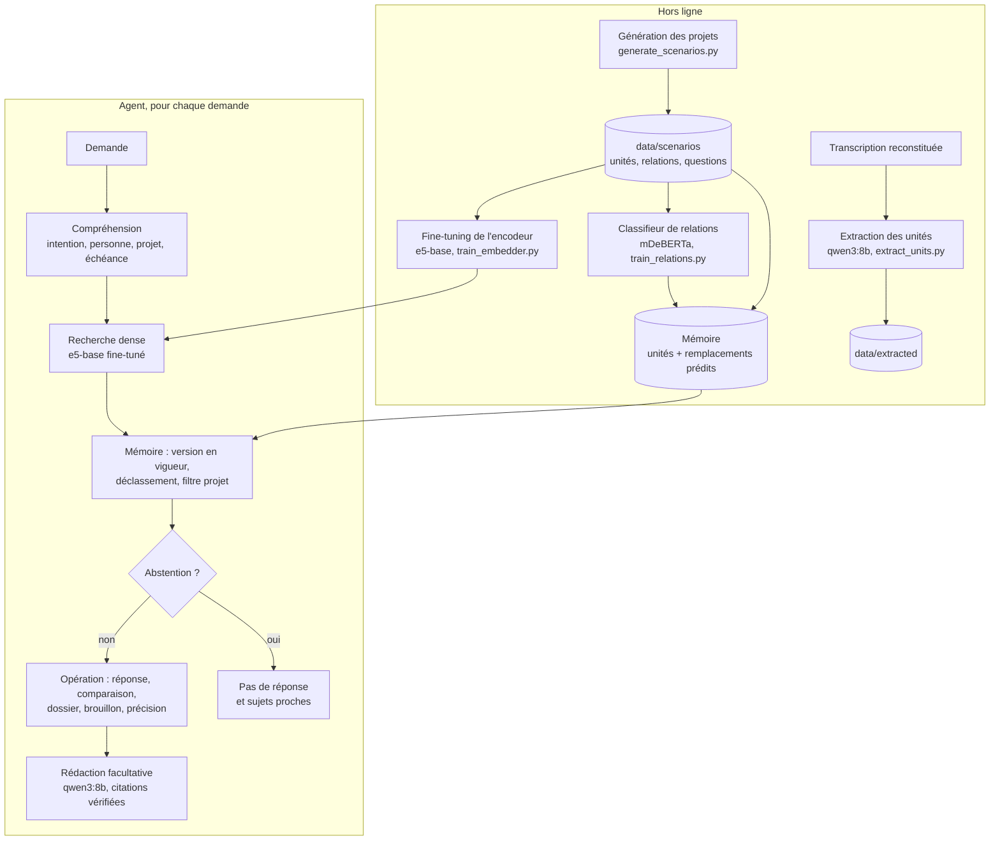
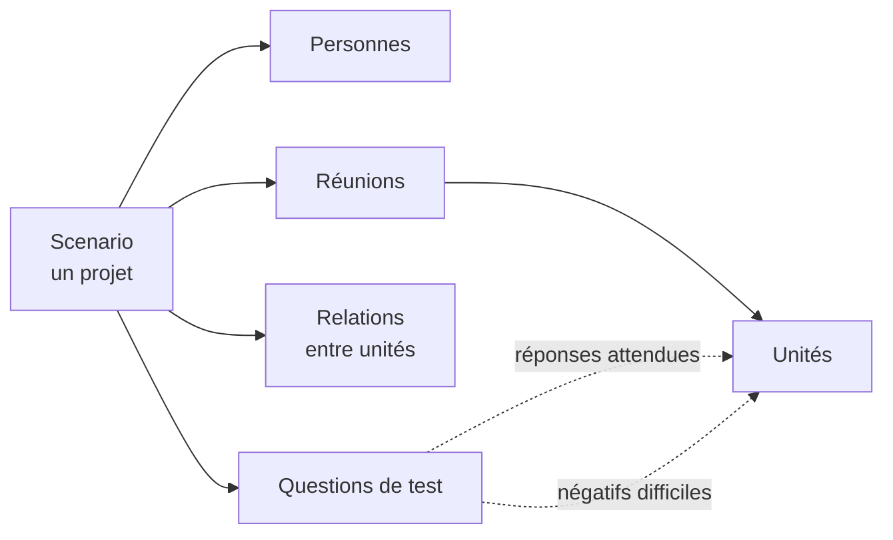
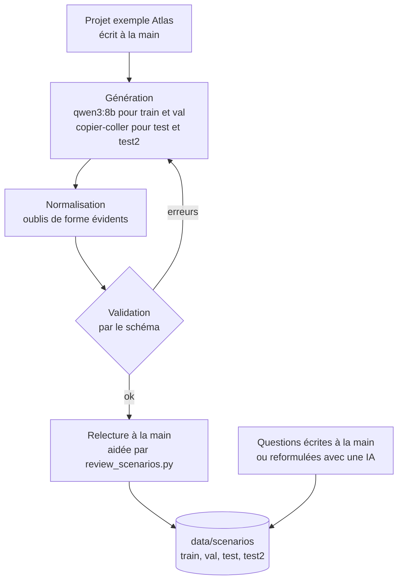
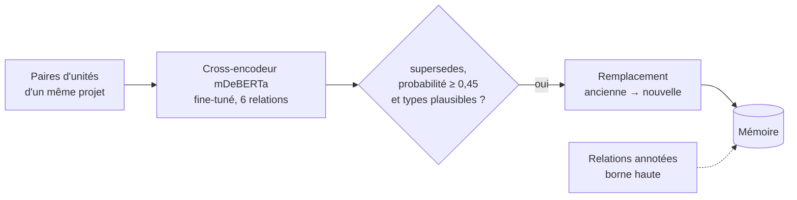
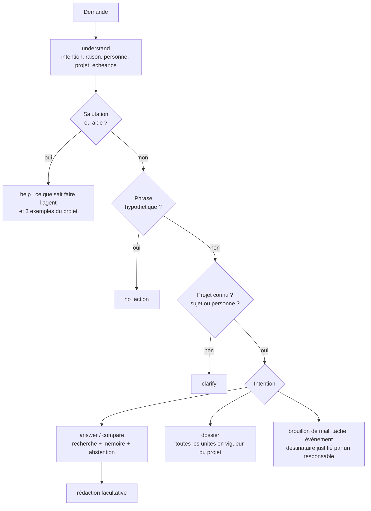

# Architecture du projet

Ce document explique comment le système fonctionne à la fin du projet : le format des données, les étapes
hors ligne (données, entraînement, mémoire), l'agent, et le rôle de chaque fichier du code.

## Fonctionnement général

Le système est découpé en étapes séparées, pour pouvoir évaluer chacune à part. Les décisions de l'agent
(intention, abstention, destinataire, brouillons) sont prises par des règles explicables. Un modèle de langue
local intervient seulement en option, à la fin, pour rédiger le texte d'une réponse à partir des unités
trouvées ; le code vérifie ce qu'il cite.

| étape | état | détail |
|---|---|---|
| Données synthétiques | fait | [DATA.md](DATA.md) |
| Recherche (BM25, e5, bge-m3) | fait | baselines dans `experiments/`, [chunking.md](chunking.md) |
| Fine-tuning de l'encodeur | fait | `models/e5b-both-type-s1` |
| Relations et mémoire | fait | relations prédites (mDeBERTa) ou annotées |
| Agent en règles | fait | [abstention.md](abstention.md), [dossiers_et_slots.md](dossiers_et_slots.md) |
| Extraction des unités | fait, évaluée à part | [extraction.md](extraction.md) |
| Reranking | mesuré, non intégré à l'agent | [reranking_et_systeme.md](reranking_et_systeme.md) |
| Rédaction par modèle local | fait, facultatif | [redaction.md](redaction.md) |
| Interface de démonstration | fait | [demo.md](demo.md) |
| Évaluation sur de vraies réunions | fait (QMSum, recherche seule) | [qmsum.md](qmsum.md) |

## Format des données

Les données sont organisées par projet. Chaque projet est un fichier JSON décrit par la classe `Scenario` de
`sae/schemas.py`. Le détail et les statistiques sont dans [DATA.md](DATA.md).

Une unité est une information précise dite en réunion :

| champ | exemple |
|---|---|
| `type` | decision, commitment, action, fact, risk, idea, question, answer |
| `status` | active, proposed, hypothetical, superseded, cancelled |
| `statement` | « Le lancement d'Atlas est reporté au 22 novembre. » |
| `evidence` | la phrase dite à l'oral |
| `speaker` / `owner` / `due_date` | qui l'a dit / qui est responsable / pour quand |
| `source_id` / `source_date` | la réunion d'origine et sa date |

Les relations relient deux unités :

| relation | sens | exemple |
|---|---|---|
| `supersedes` | nouvelle unité → ancienne | le report au 22 novembre remplace la date du 15 |
| `answers` | réponse → question | « la campagne n'est pas dans le budget » répond à la question de Sophie |
| `creates_action` | cause → action | la validation du budget entraîne la demande de l'envoyer à l'équipe |
| `supports` | preuve → affirmation | « le plan est livré » confirme l'engagement de le livrer |
| `contradicts` | entre deux unités incompatibles | |
| `unrelated` | aucun lien | |

`sae/schemas.py` décrit aussi les sorties de l'agent (brouillons de mail, de tâche et d'événement, dossier,
demande de précision). Un brouillon doit citer au moins une unité, et l'adresse e-mail reste vide si elle
n'est pas dans les données.

## Création des données

Les splits sont faits par projet. Le test vient d'un autre générateur que l'entraînement, et test2 d'un autre
générateur et d'un autre domaine.

## Recherche et fine-tuning

- **Corpus.** Un document par unité, avec le type en préfixe (« Décision : … »). J'ai aussi comparé des tours
  de parole et des fenêtres de mots ([chunking.md](chunking.md)) : les unités sont meilleures.
- **BM25.** Codé à la main (`sae/retrieval/bm25.py`), pour avoir le score de chaque document pour chaque
  question, ce qui est nécessaire pour la précision sur les négatifs difficiles. Il utilise la racinisation
  française. Les négations (« ne », « pas », « jamais ») sont gardées, parce qu'elles changent le sens. Un
  paramètre de langue permet de passer à l'anglais pour QMSum.
- **Encodeurs.** Les encodeurs denses (`sae/retrieval/dense.py`) utilisent Sentence Transformers en bf16 sur
  le GPU, avec les préfixes « query: » et « passage: » pour les e5.
- **Fine-tuning** (`scripts/train_embedder.py`, `sae/training/pairs.py`). C'est un apprentissage contrastif à
  partir d'e5-base :
  - les paires sont question → unité pertinente (76) et phrase dite → résumé de l'unité (119) ;
  - les négatifs sont explicites (les négatifs difficiles annotés) et minés par le modèle ;
  - la fonction de perte est CachedMultipleNegativesRankingLoss, 3 époques ;
  - j'ai entraîné 5 graines par configuration. Le modèle retenu, `models/e5b-both-type-s1`, utilise les deux
    sources de négatifs et le type dans le texte.

## Relations et mémoire

- **Classifieur** (`sae/relations/`, `scripts/train_relations.py`). Il prédit la relation entre deux unités
  d'un même projet. J'ai essayé une régression logistique sur des embeddings et un cross-encodeur mDeBERTa
  fine-tuné, et je garde le cross-encodeur. Le seuil de 0,45 sur `supersedes` est choisi sur val. Des règles
  de types excluent les remplacements impossibles : une question ou une réponse ne devient pas obsolète, et
  une idée ne remplace pas une décision.
- **Mémoire** (`sae/memory.py`). Elle garde les unités et les remplacements, prédits par le classifieur ou
  annotés pour la borne haute. Pour une question, `apply_memory` agit en trois temps :
  - une unité remplacée transmet son score à la version en vigueur (en bout de chaîne) ;
  - les unités inactives passent sous toutes les autres ;
  - les autres projets passent sous le projet de la question.

  Pour une question « qu'est-ce qui a changé », les anciennes versions sont gardées.
- **Coût de la prédiction.** La prédiction des relations porte sur toutes les paires d'un projet : son coût
  croît comme le carré du nombre d'unités ([reranking_et_systeme.md](reranking_et_systeme.md)).

## Extraction des unités

`sae/extraction.py` et `scripts/extract_units.py` extraient les unités d'une transcription avec qwen3:8b (via
Ollama, JSON contraint par un schéma) :

- le code ancre ensuite chaque unité dans la transcription : la phrase dite doit être une phrase de la
  réunion, les noms ceux des participants, l'échéance une date valide ;
- ce qui ne peut pas être ancré est écarté plutôt qu'inventé ;
- le statut « remplacé » n'est pas extrait : il vient ensuite du classifieur de relations.

Les unités extraites sont dans `data/extracted/`, avec leur alignement sur les unités annotées, pour mesurer
le coût de l'extraction sur toute la chaîne ([extraction.md](extraction.md)). L'agent de démonstration
utilise les unités annotées.

## Agent

- **Compréhension** (`sae/agent/understanding.py`). Ce sont des règles :
  - une intention par mots-clés, avec sa raison ;
  - un garde-fou sur les phrases hypothétiques (« on pourrait peut-être… ») ;
  - la détection des salutations et des questions sur l'agent ;
  - les paramètres : personne, projet (identifiant, nom ou nom propre du titre) et échéance.
- **Opérations** (`sae/agent/engine.py`) :
  - **réponse** : l'unité trouvée et, si elle en remplace d'autres, les anciennes versions ;
  - **comparaison** : la chaîne des versions, de la plus ancienne à celle en vigueur ;
  - **dossier** : décisions, engagements, risques, idées et historique, chaque affirmation citant son unité ;
  - **brouillons** : ils ne sont jamais envoyés. Le destinataire doit être désigné comme responsable (`owner`)
    dans une réunion, et l'agent vérifie qu'il n'a pas été réattribué depuis ;
  - **précision** : l'agent demande le projet ou le sujet quand la demande est trop vague ;
  - **abstention** : sur une question d'information, l'agent répond « pas trouvé » si le score de la première
    unité est sous un seuil calibré sur train et val (stratégie `score`, [abstention.md](abstention.md)).
- **Rédaction facultative** (`sae/agent/writer.py`). Elle s'applique aux réponses et aux comparaisons. qwen3:8b
  lit les 6 premières unités après la mémoire et rédige 1 à 3 phrases en citant leurs identifiants. Le code
  rejette la réponse dans trois cas : un identifiant cité n'est pas fourni, rien n'est cité, ou un nom propre
  ou un nombre est absent des unités citées. L'agent revient alors à l'affichage en règles. C'est désactivé par
  défaut en ligne de commande et activé dans l'interface ([redaction.md](redaction.md)).
- **Reranking** (`sae/retrieval/rerank.py`). bge-reranker-v2-m3 reclasse les 10 premiers candidats avant la
  mémoire. Il a été mesuré, mais je ne l'ai pas intégré à l'agent : il coûte environ 60 ms par question et son
  gain dépend des questions ([reranking_et_systeme.md](reranking_et_systeme.md)).

## Interface

`app/streamlit_app.py` appelle `build_agent` de `scripts/agent.py` et affiche les résultats ; elle ne change
rien à l'agent :

- le choix du projet, la démonstration des 7 cas du sujet et les exemples cliquables ;
- une carte pour chaque brouillon ;
- un bloc « Détails » avec les sources ;
- un mode comparaison avec un encodeur non entraîné.

Les modèles sont chargés une fois et la mémoire GPU est gérée pour tenir sur 8 Go ([demo.md](demo.md)).

## Organisation du code

| fichier | rôle |
|---|---|
| `sae/schemas.py` | formats des données et des sorties, avec les contrôles de cohérence |
| `sae/data.py` | chargement des projets, corpus et questions |
| `sae/chunking.py` | autres représentations du corpus (tours, fenêtres) |
| `sae/retrieval/` | `make_retriever`, BM25, encodeurs denses, reranking |
| `sae/eval/metrics.py` | Recall@K, MRR@10, nDCG@10, précision sur les négatifs difficiles |
| `sae/training/pairs.py` | paires et négatifs pour le fine-tuning |
| `sae/relations/` | paires d'unités, classifieur et mémoire prédite |
| `sae/memory.py` | mémoire et application à la recherche |
| `sae/extraction.py` | extraction des unités et alignement |
| `sae/agent/` | compréhension, agent, rédaction |
| `app/streamlit_app.py` | interface de démonstration |
| `scripts/` | une commande par étape (voir le README) |
| `tests/` | tests rapides, sans GPU ni Ollama |

## Choix des modèles

| modèle | rôle |
|---|---|
| BM25 | référence par mots-clés |
| multilingual-e5-base | encodeur principal, fine-tuné |
| multilingual-e5-small | comparaison de taille, fine-tuné aussi |
| bge-m3 | référence plus grosse, sans fine-tuning |
| bge-reranker-v2-m3 | reranking (mesuré, non intégré) |
| mDeBERTa-v3-base-xnli-multilingual-nli-2mil7 | classifieur de relations, fine-tuné |
| qwen3:8b (Ollama) | génération de train et val, extraction des unités, rédaction |

J'ai choisi e5-base parce qu'il est déjà pré-entraîné de façon contrastive, qu'il fonctionne en français et
qu'il est assez petit pour être fine-tuné sur mon GPU de 8 Go (RTX 5070 Laptop). Avec 195 paires
d'entraînement, un fine-tuning prend environ 11 secondes (10,7 s pour le modèle retenu, d'après
`experiments/train-e5b-both-type-s1/metrics.json`). Cela m'a permis de tester plusieurs configurations et
5 graines par configuration.
