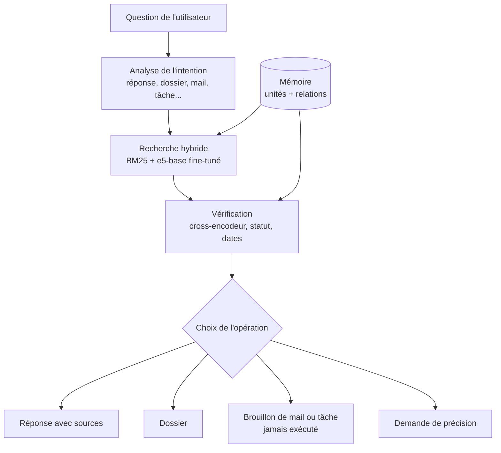
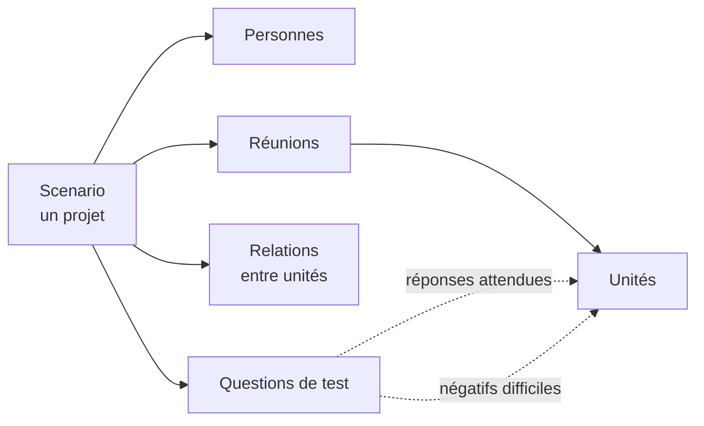
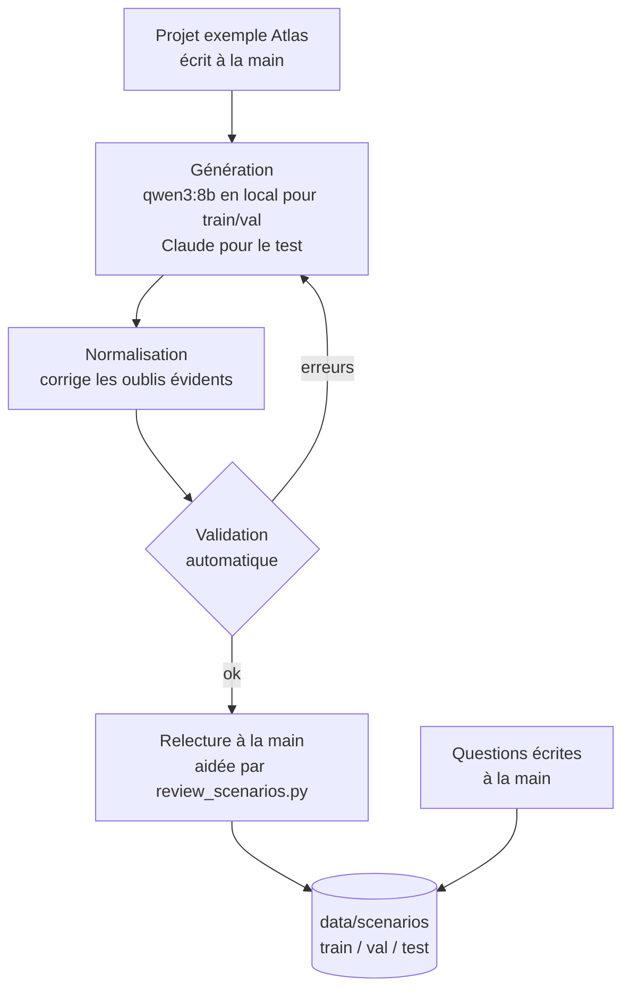

# Architecture du projet

Ce document explique comment le projet est organisé : le fonctionnement prévu du système, le format des données et le rôle de chaque partie du code. Certaines parties ne sont pas encore codées, c'est indiqué à chaque fois.

## Fonctionnement général

Le système est découpé en étapes séparées, pour pouvoir évaluer chacune indépendamment. Le modèle de langage n'intervient qu'à la fin pour rédiger la réponse : s'il faisait tout, on ne verrait plus les erreurs de la recherche.

| Étape | État |
| --- | --- |
| Recherche (BM25, e5-base) | fait, sans fine-tuning pour l'instant |
| Fine-tuning de l'encodeur | semaine 2 |
| Vérification et relations | semaine 3 |
| Intention, choix de l'opération, sorties | semaine 3 |

La recherche sert à trouver des candidats, la vérification sert à trier. Par exemple, une ancienne décision peut sortir en premier dans la recherche parce qu'elle parle du même sujet ; c'est à l'étape de vérification de voir qu'elle a été remplacée.

## Format des données

Les données sont organisées par projet. Chaque projet est un fichier JSON décrit par la classe `Scenario` dans `sae/schemas.py`.

Une **unité** est une information précise dite en réunion. Ses champs principaux :

| Champ | Exemple |
| --- | --- |
| `type` | decision, commitment, risk, idea, fact, action, question, answer |
| `status` | active, proposed, hypothetical, superseded, cancelled |
| `statement` | « Le lancement d'Atlas est reporté au 22 novembre. » |
| `evidence` | « On confirme le report au 22 novembre. » (la phrase dite à l'oral) |
| `speaker` / `owner` | qui l'a dit / qui est responsable |
| `source_id` / `source_date` | la réunion d'origine et sa date |

Les **relations** relient deux unités :

| Relation | Sens | Exemple |
| --- | --- | --- |
| `supersedes` | nouvelle unité → ancienne | le report au 22 novembre remplace la date du 15 |
| `answers` | réponse → question | « la campagne n'est pas dans le budget » répond à la question de Sophie |
| `creates_action` | cause → action | la validation du budget entraîne la demande de l'envoyer à l'équipe |
| `supports` | preuve → affirmation | « le plan est livré » confirme l'engagement de le livrer |
| `contradicts` | entre deux unités incompatibles | |
| `unrelated` | aucun lien | |

Chaque **question de test** indique les unités qui y répondent, et des négatifs difficiles : des unités sur le même sujet qui ne sont pas la bonne réponse (mauvais statut, autre personne, autre date). Une question peut aussi n'avoir aucune réponse dans les données.

Le fichier `sae/schemas.py` contient aussi les formats de sortie de l'agent (brouillon de mail, tâche, dossier…). Les brouillons ont toujours `executed: false` et `needs_confirmation: true`, et l'adresse mail reste vide si elle n'est pas dans les sources.

## Création des données

La validation automatique vérifie la forme (identifiants, dates, cohérence des remplacements). Elle ne voit pas les erreurs de logique, par exemple une relation entre deux sujets qui n'ont rien à voir. C'est pour ça que chaque projet est relu, avec l'aide de `review_scenarios.py` qui signale les cas suspects.

Les splits sont faits par projet : un projet n'est jamais à la fois en entraînement et en test. Le test est généré avec un autre modèle que l'entraînement, et complété par des questions écrites à la main, pour vérifier que le modèle n'apprend pas juste le style d'un générateur.

## Organisation du code

| Fichier | Rôle |
| --- | --- |
| `sae/schemas.py` | formats des données et des sorties, avec les contrôles de cohérence |
| `sae/data.py` | chargement des projets, construction du corpus et des questions |
| `sae/retrieval/bm25.py` | BM25 codé à la main, avec racinisation française |
| `sae/retrieval/dense.py` | encodeurs Sentence Transformers (e5, bge-m3, modèles fine-tunés) |
| `sae/eval/metrics.py` | Recall@K, MRR, nDCG et précision sur les négatifs difficiles |
| `scripts/generate_scenarios.py` | génération de projets (Ollama, ou copier-coller avec Claude) |
| `scripts/validate_data.py` | validation de tout le corpus et contrôle des fuites entre splits |
| `scripts/review_scenarios.py` | signalement des incohérences probables |
| `scripts/run_baselines.py` | évaluation des modèles sur un split |

J'ai codé BM25 moi-même au lieu d'utiliser une bibliothèque pour avoir le score de chaque unité pour chaque question. C'est nécessaire pour calculer la précision sur les négatifs difficiles. J'ai aussi gardé les mots de négation (« pas », « non », « jamais ») au lieu de les retirer comme mots vides, parce qu'ils changent le sens des phrases.

Les parties suivantes seront ajoutées au fil du projet : `sae/training/` (fine-tuning), `sae/relations/` (classification des relations), `sae/agent/` (intentions, choix de l'opération et outils simulés).

## Choix des modèles

| Modèle | Rôle |
| --- | --- |
| BM25 | référence par mots-clés |
| multilingual-e5-base | encodeur principal, qui sera fine-tuné |
| multilingual-e5-small | comparaison de la taille |
| bge-m3 | référence plus grosse, sans fine-tuning |
| bge-reranker-v2-m3 | reclassement des candidats (prévu) |
| mDeBERTa-v3 NLI | classification des relations (prévu) |

J'ai choisi e5-base parce qu'il a déjà été pré-entraîné avec de l'apprentissage contrastif, qu'il fonctionne en français, et qu'il est assez petit pour être fine-tuné sur mon GPU de 8 Go (RTX 5070 Laptop) en quelques dizaines de minutes. Ça me permet de tester plusieurs configurations dans le temps du projet.
